<!--
  Personal profile README for github.com/pir8g33k (James Eduard)
  Source: kage-github-profile\personal-profile (edit here). Publish with sync-personal.ps1 to the clone
  D:\ClaudeRepos\github\pir8g33k\pir8g33k (branch pir8g33k/JamesEduard).
  Only image file: assets/banner.svg. Badges are text-only shields.io URLs (text lives in the URL).
  Theme colours: background 0b0d10 / panel 141820 / accent ff3b30 / text e7e9ec
-->

<p align="center">
  <a href="https://www.jameseduard.com">
    
  </a>
</p>

<p align="center">
  <a href="https://www.jameseduard.com"></a>
  <a href="https://www.linkedin.com/in/jameseduardandaya/"></a>
  <a href="https://twitter.com/pir8g33k"></a>
  <a href="https://dev.to/pir8g33k"></a>
  <a href="https://www.youtube.com/channel/UCxax3q_NHJTD7BGiCkto7Fw"></a>
</p>

## Whoami

```yaml
name:      James Eduard
handle:    pir8g33k
role:      Cyber Security Architect   # SOS Group Limited
location:  Hong Kong
focus:     [security architecture, Microsoft security, detection engineering, automation]
believes:  Open source. Automate the boring parts.
fuel:      Coffee
```

I'm a Cyber Security Architect in Hong Kong. I design and build security for cloud and hybrid environments: identity, detection and the pipelines around them. Outside work I build open tools and hardware and write at [jameseduard.com](https://www.jameseduard.com).

## Selected work

| Project | What I built | Stack |
|---|---|---|
| **[Kurogane K-7 cyberdeck](https://github.com/Kage-Security-Labs/kurogane-cyberdeck)** | An open, modular **handheld Linux terminal** on a Raspberry Pi CM5 and a custom carrier board: 7" touch display, QMK keyboard with trackball, LTE/5G and hot-swap modules for GNSS, LoRa and SDR. In progress (rev A concept). | Raspberry Pi CM5 · KiCad · OpenSCAD · QMK |
| **Defender simulation range** | A self-contained **Microsoft Defender lab** on Hyper-V: an AD domain onboarded to MDE / MDI / MDO, attack and phishing simulations, cloud-identity scenarios adapted from SimuLand, and a local control panel. | PowerShell · Hyper-V · KQL · MITRE ATT&CK |

## Focus

| `BUILD` — DevSecOps | `WATCH` — Detection | `BREAK` — Offensive |
|---|---|---|
| Pipelines that ship fast and ship safely. | Telemetry that tells the whole story. | Test it before someone else does. |
| ▸ CI/CD & GitHub Actions | ▸ Microsoft Sentinel & KQL | ▸ Kali Linux tooling |
| ▸ Infrastructure as code (Terraform) | ▸ Defender XDR & Entra ID | ▸ Active Directory assessment |
| ▸ Linux, containers & hardening | ▸ Zabbix & Prometheus monitoring | ▸ Attack simulation labs |

## Stack

**Security**

| <br><sub>Microsoft Sentinel</sub> | <br><sub>Defender XDR</sub> | <br><sub>Entra ID</sub> | <br><sub>Conditional Access</sub> | <br><sub>KQL</sub> | <br><sub>Kali Linux</sub> | <br><sub>FortiGate</sub> |
|:---:|:---:|:---:|:---:|:---:|:---:|:---:|

**Platforms & ops**

| <br><sub>Azure</sub> | <br><sub>Microsoft 365</sub> | <br><sub>Linux</sub> | <br><sub>Windows Server</sub> | <br><sub>Ubuntu</sub> | <br><sub>Docker</sub> | <br><sub>Terraform</sub> |
|:---:|:---:|:---:|:---:|:---:|:---:|:---:|

**Code & tools**

| <br><sub>PowerShell</sub> | <br><sub>Python</sub> | <br><sub>Bash</sub> | <br><sub>JavaScript</sub> | <br><sub>PHP</sub> | <br><sub>Git</sub> | <br><sub>VS Code</sub> |
|:---:|:---:|:---:|:---:|:---:|:---:|:---:|

**Frameworks**<br>


## Writing

**Personal blog** · [jameseduard.com](https://www.jameseduard.com)

<!-- BLOG-POST-LIST:START -->
- [How to Export and Import Your Linux Systems on Windows 10](https://jameseduard.com/?p=4048)
- [Visual Studio Code Remote on Windows Subsystem for Linux](https://jameseduard.com/?p=4045)
- [How To Install Terraform on CentOS 8](https://jameseduard.com/?p=4061)
- [How To Install InfluxDB on CentOS 8 / RHEL 8](https://jameseduard.com/?p=3239)
- [Visual Studio Code Remote – SSH](https://jameseduard.com/?p=4021)
<!-- BLOG-POST-LIST:END -->

## Get in touch

| Channel | Where |
|---|---|
| Website | [jameseduard.com](https://www.jameseduard.com) |
| Email | [business@jameseduard.com](mailto:business@jameseduard.com) |
| LinkedIn | [jameseduardandaya](https://www.linkedin.com/in/jameseduardandaya/) |
| X | [@pir8g33k](https://twitter.com/pir8g33k) |
| DEV | [dev.to/pir8g33k](https://dev.to/pir8g33k) |
| Coffee | [buymeacoffee.com/pir8g33k](https://www.buymeacoffee.com/pir8g33k) |

---

<p align="center"><b>Open to collaborations. Coffee helps.</b><br><sub>Wasting my time to save other people's time.</sub></p>
