<!--
  Personal profile README for github.com/pir8g33k (James Eduard)
  Repo: pir8g33k/pir8g33k (default branch: master). Art lives in ./assets.
  Theme matches kagesecuritylab.com (bg #07080a, accent #ff3b30) without Kage branding.
-->

<p align="center">
  <a href="https://www.jameseduard.com">
    
  </a>
</p>

<p align="center">
  <a href="https://www.jameseduard.com"></a>
  <a href="https://www.linkedin.com/in/jameseduardandaya/"></a>
  <a href="https://twitter.com/pir8g33k"></a>
  <a href="https://dev.to/pir8g33k"></a>
  <a href="https://www.youtube.com/channel/UCxax3q_NHJTD7BGiCkto7Fw"></a>
  <a href="https://www.facebook.com/Pir8g33k"></a>
</p>

<br>



```yaml
name:      James Eduard
handle:    pir8g33k
role:      DevSecOps engineer
founder:   Kage Security Labs
location:  Hong Kong
focus:
  - DevSecOps: CI/CD, infrastructure as code, hardening
  - Detection: Microsoft Sentinel, Defender XDR, KQL
  - Offensive: Active Directory, attack simulation labs
believes:  Open source. Automate the boring parts.
fuel:      Coffee
```

Open source advocate. I build, watch and break systems so the next person has less to fix. Always happy to collaborate.

<br>



<p align="center">
  
</p>

<br>


<p align="center">
  
</p>

<br>



<!-- BLOG-POST-LIST:START -->
- [Export and import Linux distributions on Windows 10 (WSL)](https://jameseduard.com/?p=4048)
- [VS Code Remote on Windows Subsystem for Linux](https://jameseduard.com/?p=4045)
- [Install Terraform on CentOS 8](https://jameseduard.com/?p=4061)
- [Install InfluxDB on CentOS 8 / RHEL 8](https://jameseduard.com/?p=3239)
- [VS Code Remote over SSH](https://jameseduard.com/?p=4021)
<!-- BLOG-POST-LIST:END -->

<br>



| Channel | Where |
|---|---|
| Website | [jameseduard.com](https://www.jameseduard.com) |
| Business | [business@jameseduard.com](mailto:business@jameseduard.com) |
| LinkedIn | [jameseduardandaya](https://www.linkedin.com/in/jameseduardandaya/) |
| X | [@pir8g33k](https://twitter.com/pir8g33k) |
| DEV | [dev.to/pir8g33k](https://dev.to/pir8g33k) |
| Coffee | [buymeacoffee.com/pir8g33k](https://www.buymeacoffee.com/pir8g33k) |

<!-- Optional GitHub stats in the same colours. Delete the comment markers to enable.
<p align="center">
  
  
</p>
-->

<br>

<p align="center">
  <a href="https://www.buymeacoffee.com/pir8g33k"></a>
</p>
